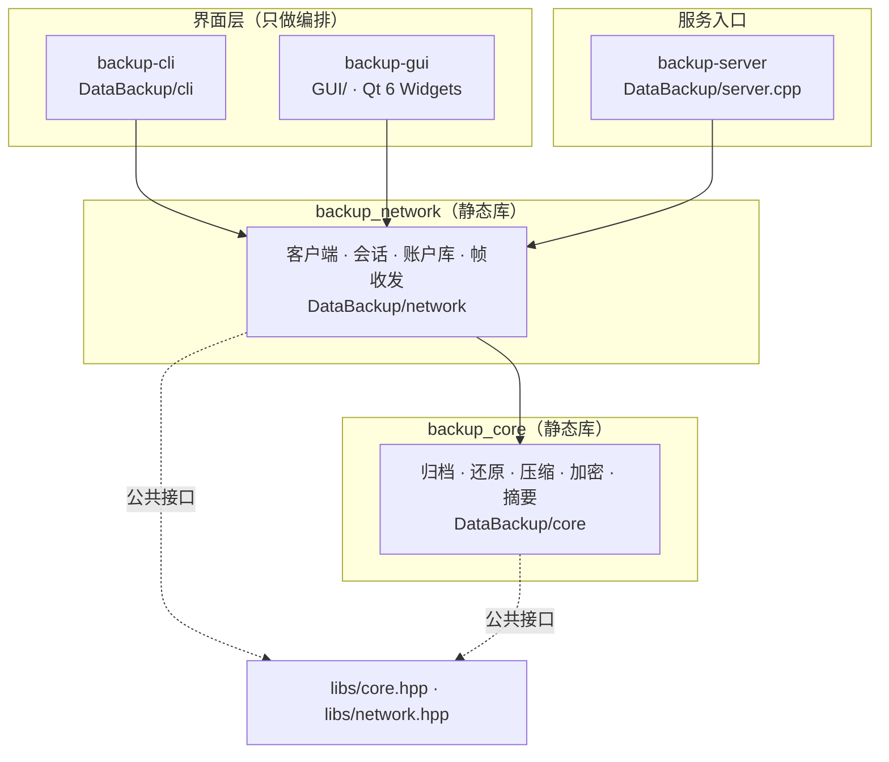
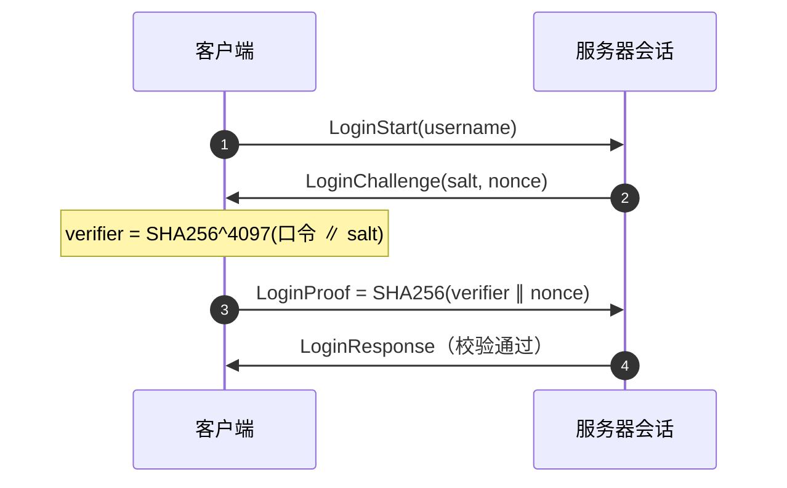
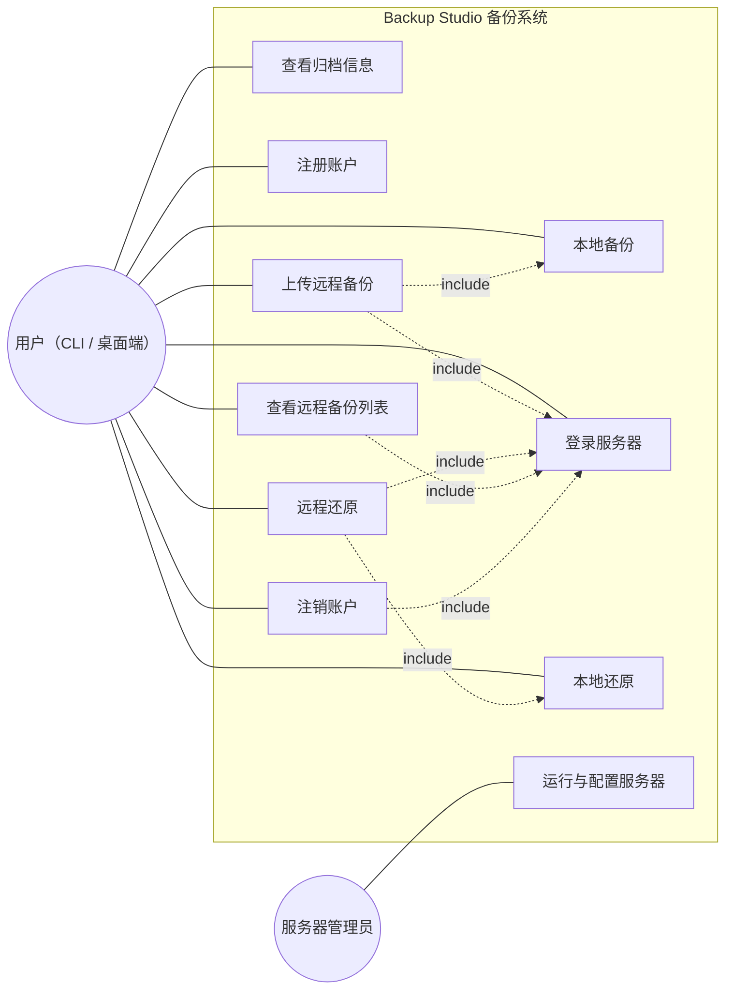
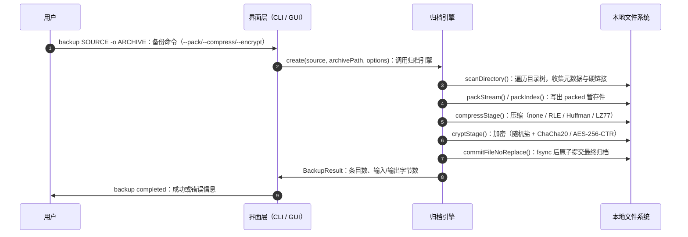
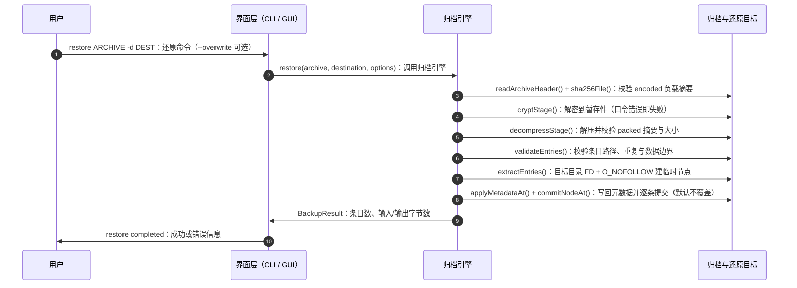
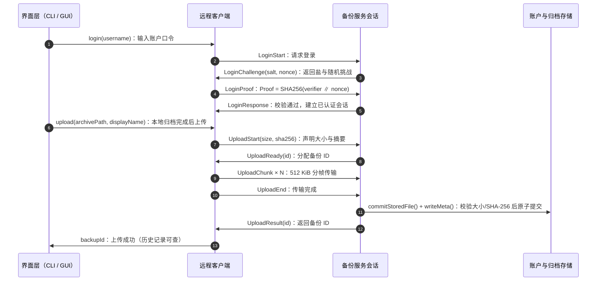
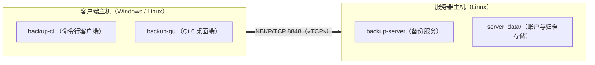

# Backup Studio 备份系统 系统设计文档

| 项目 | 内容 |
| :--- | :--- |
| 文档名称 | 系统设计文档（概要设计与详细设计） |
| 文档版本 | 1.7 |
| 对应软件版本 | 1.11.0 |
| 对应代码基线 | 与本文件所在 Git 提交的源码一致 |
| 编制日期 | 2026-10-28 |
| UML 模型 | `DataBackup.mdj`（StarUML，6 张图） |
| 状态 | 与 1.11.0 实现同步 |

## 1 引言

### 2026-10-27 条目选择修订

- 新增 `BackupOptions::includes` 与 `BackupEngine::scanSource()`：前者在扫描阶段
  过滤条目，后者按同一条扫描路径为选择界面提供条目清单（相对路径、类型、大小、
  mtime），不跟随符号链接。
- 新增 CLI 可重复选项 `--include`，只对 `backup` 与 `remote-backup` 生效；
  可重复选项与单值选项一样按命令白名单校验。
- 新增 Qt 条目选择对话框，本地备份页与远程备份页共用；选择随源目录变化清空。
- 归档格式、网络协议与还原语义均未改变：`includes` 为空时扫描行为与 1.8.1 一致。

### 2026-10-23 后端修订

- 服务入口先解析选项，再加载配置、应用显式覆盖；重复参数和配置读取故障直接报错。
- 监听 FD 由 `run()` 内 RAII 对象独占；`stop()` 只发取消标志，100 ms poll 周期检查
  停机并回收已完成线程，避免跨线程关闭 FD 的复用竞态。超过连接上限的回复有 1 秒
  超时并接受停机取消；线程表按连接上限预留空间，接受到的 socket 在启动 worker 前由 RAII 管理。
- 注册只在读改写账号库时持有存储锁，回复网络消息时释放；所有错误回复接收取消标志。
- 一个 NBKP 帧的头和负载合并发送，减少小消息与 TCP delayed ACK 的交互等待；文件传输
  复用块缓冲区。上传摘要在建立连接前计算，下载暂存复用 `TempFile`，由 mkstemp 创建并统一清理。
- 上传归档发布与元数据发布共用异常清理范围，覆盖文件 fsync 和目录 fsync 的四个失败点。
  元数据读取核对名称长度/NUL、摘要字符、截断及尾随数据；列表在扫描时实施条目数上限。
- 未启用的压缩/加密阶段复用上一阶段路径，保留阶段完成事件和取消检查；有变换时才分配对应
  暂存文件。无变换备份复用 packed 摘要，还原仍核对实际解码文件的 packed 摘要。

本轮保持 BKP2、NBKP 编码及外部备份/还原接口兼容，不新增依赖。

### 1.1 编写目的

说明 Backup Studio 的总体架构、模块划分、关键数据结构与算法、接口和错误处理
策略，使实现、测试与需求三者可相互追溯。本文档与 `docs/requirements.md`
的 FR/NFR 编号对应，映射关系见第 4 节开头的需求覆盖表。

### 1.2 术语

与 `docs/requirements.md` 1.3 节一致。`packed` 指打包阶段输出的数据，
`encoded` 指压缩加密后的负载，`BKP2` 为归档容器格式，`NBKP` 为网络协议。

## 2 设计目标与原则

1. **分层与依赖边界**：核心归档逻辑不依赖网络与界面；界面只做编排。
2. **零外部算法依赖**：压缩与加密全部自研，只使用 C++17 与 POSIX。
3. **安全默认**：还原默认不覆盖；路径解析受目录 FD 约束；网络协议只在
   可信网络使用，机密性交给归档加密。
4. **原子提交**：归档发布、服务器存储提交都遵循「临时文件 + `fsync` +
   不覆盖重命名」。失败只留下暂存件，不产生半成品。
5. **失败必须可诊断**：区分「不存在」「空集合」与真实错误；取消、权限、
   磁盘写满等异常返回可定位原因。
6. **可测试性**：核心、网络、CLI、GUI 都能在 CTest 中离屏运行；网络用例
   使用本机临时端口，文件系统用例使用临时目录。

## 3 总体架构

### 3.1 分层视图

- `backup_core`：本地归档与还原，公共头 `libs/core.hpp`。
- `backup_network`：依赖 core，提供客户端与服务器，公共头 `libs/network.hpp`。
- `DataBackup/cli/`、`GUI/`、`DataBackup/server.cpp`：命令行解析、界面编排、
  进程入口，不含业务规则。

### 3.2 模块清单

| 模块 | 主要文件 | 职责 | 关键约束 |
| :--- | :--- | :--- | :--- |
| 公共接口 | `libs/core.hpp`、`libs/network.hpp` | 类型、枚举、回调与生命周期约定 | 参数约束、异常与线程语义写在头文件注释 |
| 引擎 | `core/engine.cpp` | `create`/`restore`/`preview`/`inspect`/`scanSource` 门面 | 失败返回 `BackupResult.message`，不抛给界面 |
| 扫描与条目 | `core/entry.cpp` | 目录树扫描、条目选择过滤与核对、元数据编解码、路径与条目校验 | 路径安全、去重、硬链接目标先于别名、选中集合必须全部存在 |
| 打包 | `core/pack.cpp` | `stream`/`index` 两种布局 | 两种布局都做边界与尾部校验 |
| 压缩 | `core/compress_rle.cpp`、`core/compress_huffman.cpp`、`core/compress_lz77.cpp` | 自研 RLE、Huffman 与 LZ77 | 解压必须按期望大小设上限 |
| 加密 | `core/crypto.cpp` | KDF、ChaCha20（RFC 8439）、AES-256-CTR | 只做异或流，支持按位置续算 |
| 摘要 | `core/sha256.cpp` | SHA-256、文件区间摘要 | 支持偏移与长度、可取消 |
| 归档容器 | `core/archive.cpp` | 头部读写、解码流水线 | 先校验再消费，回调内完成提取 |
| 还原 | `core/restore.cpp` | FD 约束提取、临时节点、元数据 | 逐条提交，不做整目录回滚 |
| 网络收发 | `network/io.cpp` | 帧编解码、超时、可取消 I/O | 帧头 16 字节，负载 ≤ 1 MiB |
| 账户库 | `network/auth_store.cpp` | 用户记录、校验值、存储目录 | 只存盐与校验值，目录 0700 |
| 服务 | `network/server.cpp` | 监听、连接上限、worker 线程 | 每连接一线程，受上限与超时约束 |
| 会话 | `network/session.cpp` | 登录、上传、列表、下载、注销 | 已认证会话计数防注销竞态 |
| 客户端 | `network/client.cpp` | 同步调用、进度与取消 | 30 秒等待超时并轮询取消 |
| CLI | `cli/arguments.cpp`、`cli/commands.cpp`、`cli/main.cpp` | 选项解析、命令分派 | 每命令白名单校验选项 |
| GUI | `GUI/*.cpp` | 六页面（导航分本地/远程两组）、登录页的登录与预设、条目选择对话框、任务线程、样式 | 任务可取消，关闭窗口等待清理 |

### 3.3 目录结构

客户端的响应类型、请求编号与服务端错误统一在私有 `receiveResponse` 中检查；
认证异常由公共调用入口统一转换为错误结果，不再捕获后重新抛出。

| 路径 | 内容 |
| :--- | :--- |
| `libs/` | 公共接口（`core.hpp`、`network.hpp`） |
| `DataBackup/core/`、`DataBackup/network/` | 实现（含 `internal.hpp` 私有头） |
| `DataBackup/cli/`、`DataBackup/server.cpp` | CLI 与服务进程入口 |
| `GUI/` | Qt 6 页面、控件、对话框、样式 |
| `test/` | 核心、CLI、GUI、WSL 启动器测试 |
| `Utils/` | WSL 构建脚本、发布打包脚本与性能验收脚本 |
| `packaging/` | 安装包资产：桌面项、图标、systemd 单元、deb 维护脚本、Windows WSL2 安装器、安装说明 |
| `Dockerfile`、`docker-compose.yml` | 服务端容器交付 |
| `exp/`、`output/` | 示例输入与生成输出（后者不进入版本库） |
| `DataBackup.mdj` | StarUML 模型（类图、用例图、时序图、部署图） |

## 4 详细设计

需求覆盖映射（详细设计小节 ↔ `docs/requirements.md` 编号）：

| 设计小节 | 覆盖需求 |
| :--- | :--- |
| 4.1 归档管线 | FR-01、FR-13、FR-14、NFR-01、NFR-10 |
| 4.2 归档格式 BKP2 | FR-01、FR-04、FR-15、NFR-02、NFR-04 |
| 4.3 压缩设计 | FR-14、NFR-02、NFR-04 |
| 4.4 加密设计 | FR-14、NFR-03、NFR-04 |
| 4.5 还原设计与安全约束 | FR-02、FR-03、FR-05、FR-15、NFR-03、NFR-10 |
| 4.6 网络服务设计 | FR-06、FR-08、FR-09、FR-10、FR-12、FR-16、NFR-02 |
| 4.7 NBKP 协议设计 | FR-06、FR-07、FR-08、FR-09、FR-10、FR-11、NFR-03、NFR-04 |
| 4.8 CLI 设计 | FR-01、FR-02、FR-03、FR-04、FR-14 |
| 4.9 GUI 设计 | FR-05、FR-11、FR-13、NFR-07 |
| 4.10 测试支撑设计 | NFR-08、NFR-09 |
| 4.11 条目选择 | FR-17、NFR-09、NFR-10 |

### 4.1 归档管线

- 阶段之间使用临时文件；条目元数据驻留内存，文件数据按 1 MiB 缓冲流式处理。
- 头中的 `packedSize`/`packedDigest` 在打包后立即计算，`encodedSize`/
  `encodedDigest` 在加密后计算；还原时逐层校验，任何一层不匹配即拒绝。
- 进度回调按阶段上报（`scan`、`pack`、`compress`、`encrypt`、`finalize`、
  `read-archive`、`decrypt`、`decompress`、`restore-entry`）；
  取消检查点分布在每个阶段与每条目之间，取消不提交最终产物。
- 归档输出必须在源目录之外、路径不存在；父目录 fsync 失败会报告
  「归档已发布」，避免误判为未生成。
- 有条目选择时，扫描阶段只保留选中条目、其祖先目录与选中目录的整棵子树；
  未选中的分支不进入。选中集合在扫描末尾逐项核对，缺项即失败（见 4.11）。

### 4.2 归档格式 BKP2

#### 4.2.1 头（112 字节）

| 偏移 | 长度 | 字段 | 说明 |
| ---: | ---: | :--- | :--- |
| 0 | 4 | 魔数 | `BKP2` |
| 4 | 2 | 版本 | 1 = 旧布局；2 = 增加硬链接；3 = 增加 LZ77 压缩。写入时取满足内容的最低版本，可读 1/2/3 |
| 6 | 2 | 头长 | 固定 112，校验用 |
| 8 | 4 | 标志 | bit0 恒 1；bit1 = 有压缩；bit2 = 有加密；其余必须为 0 |
| 12 | 1 | 打包算法 | 1 = `stream`，2 = `index` |
| 13 | 1 | 压缩算法 | 0 = none，1 = RLE，2 = Huffman，3 = LZ77（要求版本 ≥ 3） |
| 14 | 1 | 加密算法 | 0 = none，3 = ChaCha20，4 = AES-256-CTR（1、2 已随旧密码退役） |
| 15 | 1 | 保留 | 必须为 0 |
| 16 | 8 | packed 大小 | 约束：`encodedSize == 文件大小 − 112` |
| 24 | 8 | encoded 大小 | |
| 32 | 16 | 盐 | 加密时随机生成；非加密时同样占用 |
| 48 | 32 | packed 摘要 | SHA-256(packed 数据) |
| 80 | 32 | encoded 摘要 | SHA-256(encoded 负载) |

校验规则：标志位必须与算法 id 一致；压缩 id 3 要求版本 ≥ 3，否则以
「LZ77 compression requires archive version 3」拒绝；加密 id 1/2 一律拒绝
并给出「旧版 XOR/Vigenere 不再支持」的提示。

#### 4.2.2 条目元数据

| 字段 | 类型 | 约束 |
| :--- | :--- | :--- |
| 路径 | 字符串（≤ 1 MiB） | 相对路径，拒绝绝对路径、`.`、`..`、空分量、NUL、反斜杠混用；全局唯一 |
| 类型 | u8 | 1 普通文件、2 目录、3 符号链接、4 FIFO、5 字符设备、6 块设备、7 套接字、8 硬链接 |
| 权限位 | u32 | 仅 `07777` |
| 属主/属组 | u32 ×2 | |
| 大小 | u64 | 非普通文件必须为 0 |
| atime/mtime/ctime | i64 秒 + u32 纳秒 ×3 | 纳秒 < 10⁹ |
| 链接目标 | 字符串 | 仅符号链接与硬链接可非空 |
| 设备号 | u64 | 仅字符/块设备 |
| 内容偏移 | u64 | 仅索引式；必须落在数据区内 |

#### 4.2.3 两种打包布局

- **`stream`（顺序式）**：`STRMPK1\0`（8B）+ 条目数（u32）+ 逐条
  `ENTR` 标记 + 元数据 + 数据。读取时顺序推进，要求「无尾部多余数据」。
- **`index`（索引式）**：`INDXPK1\0`（8B）+ 文件数据区（仅普通文件内容，
  便于跳过）→ 中央目录 `CDIRV1\0\0` + 条目数 + 带偏移的元数据 →
  尾部 `IDXEND1\0` + 中央目录偏移 + 长度 + 条目数 + 保留位。
  读取时先验证尾部与中央目录边界，再按偏移取数据；偏移不得与中央目录重叠。

### 4.3 压缩设计

| 算法 | id | 输出格式 | 关键约束 |
| :--- | ---: | :--- | :--- |
| RLE | 1 | 长度前缀块序列，最长匹配 255 | 解压按期望大小设上限，超出即失败 |
| Huffman | 2 | 频率表 + 规范码表 + 位流 | 建树节点数与位流长度受限；解压后必须恰好等于期望大小 |
| LZ77 | 3 | 流头 + 分块 + token 流（见 4.3.1） | 块内独立编码；每个长度、距离与扩展字节都按块大小校验 |

三者都只处理 packed 数据整体，不改动条目边界；解压失败一律视为归档损坏或
口令错误（外层可能因解密错误导致解压异常）。压缩 id = 3 的归档必须声明
版本 ≥ 3，旧版本头搭配 LZ77 一律拒绝。

#### 4.3.1 LZ77 流格式与编码策略

- 流头：`LZ77`（4 字节）+ 原始大小（u64，必须等于头中的 `packedSize`）。
- 分块：每块 1 MiB（末块可短），块头为
  `标志(u8) + 原始长度(u32) + 负载长度(u32) + 负载`；标志 0 = token 流，
  1 = 原样存储。块间独立编码，字典不跨块，因此峰值内存与归档总大小无关。
- 不变量：token 块的负载必须**小于**对应的原始块，否则必须写成存储块。
  这既把单块负载限制在 1 MiB 以内，也在格式层面保证“压缩不会让负载变大”。
- token 流：序列 = 记号字节 + 字面量 + 2 字节距离（小端）。记号高 4 位为
  字面量个数、低 4 位为“匹配长度 − 3”（最小匹配 3）；nibble 为 15 时用
  255 进制扩展字节续接。块内最后一段只含字面量，字面量填满块即结束，
  因此没有单独的结束标记。
- 编码器：64 KiB 窗口（距离 2 字节）、最长匹配 65535、哈希链搜索深度
  上限 64、单步惰性匹配（下一位置的匹配更长时改为输出字面量）；被匹配
  覆盖的位置不写入哈希链，以时间换实现简单。
- 解码校验：字面量与匹配长度不得超过块内剩余空间；距离必须满足
  `1 ≤ 距离 ≤ 已产出字节数`，因此重叠复制不会读出块外；块内负载必须
  恰好耗尽，流末尾不得有多余数据。
- 进度与取消：阶段为 `compress-lz77` / `decompress-lz77`，取消检查点
  分布在每个块边界。

### 4.4 加密设计

| 项 | 设计 |
| :--- | :--- |
| KDF | `key = SHA256^4097(口令 ∥ 盐)`（1 次 + 4096 轮），盐 16 字节随机 |
| ChaCha20 | RFC 8439 IETF 变体（12 字节 nonce 取盐前 12 字节，32 位块计数器），按 64 字节块异或，支持任意位置续算；总长限制 2³⁸ 字节 |
| AES-256-CTR | 自研轮函数与密钥扩展，16 字节计数器初值取盐，按块产生密钥流并异或 |
| 流式处理 | 1 MiB 缓冲；`position` 单调递增，支持按位置恢复 |
| 约束 | 只做异或流（无认证标签），完整性由头中的 SHA-256 与解码后的 packed 摘要保证 |

### 4.5 还原设计与安全约束

| 措施 | 说明 |
| :--- | :--- |
| 先校验后落地 | 负载摘要 → 解密 → 解压 → packed 摘要与大小 → 条目校验，全部通过才开始创建节点 |
| 目录 FD 约束 | 打开目标目录 FD（`O_RDONLY|O_DIRECTORY|O_NOFOLLOW`），所有解析用 `openat`/`*at` 逐层前进，不使用拼接路径 |
| 拒绝符号链接逃逸 | 每层 `O_NOFOLLOW`；元数据用 `AT_SYMLINK_NOFOLLOW` |
| 临时节点 + 重命名 | 条目先建唯一临时名（普通文件 `O_CREAT|O_EXCL|O_NOFOLLOW`，其他用 `mknodat`/`mkfifoat`/`symlinkat`/`linkat`），核对后再提交为目标名 |
| 覆盖策略 | 默认拒绝冲突；`--overwrite` 时才替换，且替换同样经过临时节点 |
| 硬链接校验 | 恢复时用 `fstatat` 核对设备号与 inode 与首次恢复结果一致，竞态替换不提交 |
| 元数据失败上报 | `fchownat`/`fchmodat`/`utimensat` 失败必须返回错误（不静默忽略）；已还原条目保留 |
| 提交粒度 | 每条目独立提交，不做整目录回滚；目录元数据在最后按深度反序写回 |

### 4.6 网络服务设计

| 项 | 设计 |
| :--- | :--- |
| 监听 | `bind`/`listen`，缺省 `0.0.0.0:8848`（`bind_address`/`--bind` 限定 IPv4 字面量，一体包用 `127.0.0.1`）；`SIGINT`/`SIGTERM` 触发 `stop()` |
| 并发 | 每连接一个工作线程（`detach` 前登记），连接数受 `max_connections` 限制，超出即拒绝 |
| 超时 | 每个套接字设置 30 秒收发超时（可配置），I/O 循环轮询取消标志 |
| 账户库 | `users.db`：用户名 + 16B 盐 + 32B 校验值；写入走临时文件 + 原子重命名；读失败或格式错误拒绝操作，不覆盖原文件 |
| 存储布局 | `<storage>/<username>/`（0700），归档 `<id>.bak`（0600）与 `<id>.meta` |
| ID | 随机不可预测；生成后检查不冲突 |
| 上传提交 | 暂存文件 → 声明大小校验 → SHA-256 校验 → `commitStoredFile`（不覆盖）→ 写元数据；元数据失败则删除归档，避免半成品 |
| 注销 | 要求该账户无已存储备份且无其他已认证连接；删除账户记录，不删除任何备份文件 |
| 会话回收 | 已认证连接计数在账户库锁内维护，防止「登录后账户被删」竞态 |

### 4.7 NBKP 协议设计

#### 4.7.1 帧

| 偏移 | 长度 | 字段 |
| ---: | ---: | :--- |
| 0 | 4 | 魔数 `NBKP` |
| 4 | 2 | 协议版本（1） |
| 6 | 2 | 消息类型 |
| 8 | 4 | 请求 ID（响应必须回显） |
| 12 | 4 | 负载长度（≤ 1 MiB） |

#### 4.7.2 消息

| 类型 | 名称 | 负载 |
| ---: | :--- | :--- |
| 1/2 | 注册请求/响应 | 用户、盐、校验值 / 空 |
| 3/4/5/6 | 登录开始/挑战/证明/结果 | 用户名 / 盐+nonce / 32B 证明 / 空 |
| 10/11/12/13/14 | 上传开始/就绪/分块/结束/结果 | 名称+大小+摘要 / ID / 数据 / 空 / ID |
| 20/21 | 列表请求/响应 | 空 / 条目数组（≤ 4096 条且 ≤ 1 MiB） |
| 30/31/32/33 | 下载请求/开始/分块/结束 | ID / 大小+摘要 / 数据 / 空 |
| 40/41 | 注销请求/响应 | 空 / 空 |
| 255 | 错误 | 错误文本 |

#### 4.7.3 登录时序（挑战-响应）

- 口令错误与用户名不存在返回同一错误文本，避免枚举用户。
- `LoginProof` 必须与其挑战的请求 ID 对应；无匹配挑战一律拒绝。
- 每次上传/下载/列表都在已认证会话内独立完成，不依赖「已登录过」的状态。

### 4.8 CLI 设计

- `parseArgs` 只做词法解析；`validateArguments` 按命令白名单校验选项，
  重复选项、非法数值（`from_chars` 严格解析：拒绝 `+80`、`80junk`、
  前导空格、溢出）与多余位置参数一律拒绝。
- 口令优先级：`--key-file`/`--account-password-file` > 交互输入（不回显）。
- 可重复选项（`--include`）存放于 `Arguments::repeated`，保留出现顺序；
  校验与单值选项共用同一份命令白名单，因此未声明该选项的命令会被拒绝。
- 退出码：成功 0；参数与运行错误 1；`--help` 无参数时为 1。

### 4.9 GUI 设计

- 六个页面：起始页、本地备份、本地还原、远程备份、远程还原、备份历史。
- 后台任务：`startJob` 在 `QThread` 中执行 `Job`（`std::function`，接收取消
  标志与进度回调），窗口关闭时置位全部取消标志并等待线程结束。
- 数据显示与业务分离：算法选项由 `snapshotAlgorithms` 打包成纯数据再传库；
  远程页的连接参数改由 `AccountSession` 提供（见 4.12）。
- 账户会话 `AccountSession` 用 `revision` 忽略过期的异步登录结果；口令只存在
  内存。
- 字体按窗口尺寸分档（1500×1000、1800×1200、2100×1400）离散调整，正文
  不小于 16pt；导航宽度随窗口变化。
- 条目选择对话框按路径前缀建树，勾选目录即勾选整棵子树；筛选只影响可见性，
  不改变选择；选择属于一个源目录，源路径变化即清空（见 4.11）。
- 对话框的类别、大小、时间与隐藏筛选都在已有扫描元数据（路径、类型、大小、
  mtime）上计算，不重读文件系统；类别只归属普通文件，目录靠子项可见性传播保留。
- 本地与远程任务启动前复制选择列表，工作线程只读取快照，后续源目录或勾选修改
  仅影响下一次任务。

### 4.10 测试支撑设计

- `test/helpers.cpp` 提供临时目录、完整目录树比较、套接字节点等夹具。
- 链接期 `-Wl,--wrap=fsync` 在 OS 边界注入失败，不在核心内部打桩。
- CLI 与 GUI 测试分别用 Python 脚本与 Qt Test；GUI 离屏运行。
- `Utils/build-wsl.sh` 在 WSL 内完成 format-check → 并行构建 → CTest →
  离屏 GUI 截图校验；`Utils/run_performance_test.sh` 记录时间与峰值内存。

### 4.11 条目选择

- 选择以「源目录相对路径」表达（`BackupOptions::includes`），分隔符固定为 `/`，
  只接受源目录以下的条目；空列表表示整目录，与 1.8.1 行为一致。
- 扫描前先做词法规整（`./docs//manual/../manual/a.txt` → `docs/manual/a.txt`），
  并去除目录尾斜杠（`src/` 与 `src` 等价），
  再拒绝绝对路径、规整后仍含 `..` 的路径、空串与单独一个 `.`；随后去重排序，
  使成员判断与祖先判断都用二分查找，扫描成本与选中数量成对数关系。
- 每个条目判断三件事：条目本身被选中、条目是某选中项的祖先、条目位于某选中项
  之下。三者皆否即跳过，并对目录关闭递归，未选分支不再进入。因此选中
  `src/nested/deep.bin` 会一并带上 `src`、`src/nested`，还原后仍复原原结构。
- 选中目录保留整棵子树；选中符号链接只存链接本身，不跟随目标。
- 硬链接在过滤后重新判定：只选中别名而内容条目被排除时，别名退化为普通文件，
  不产生悬空硬链接；两者都被选中时保持硬链接关系，BKP2 v2 语义不变。
- 扫描结束后按选中集合核对归档路径，缺项立即报错并清理暂存件，
  不产生「看起来完整」的部分归档。
- `BackupEngine::scanSource()` 复用同一条扫描路径；对外只报告相对路径、类型、
  大小（普通文件与硬链接）与 mtime，顺序稳定，供选择界面使用。
- GUI 对话框在确认时收集「最小选中集合」：整目录被勾选时不再重复其子项；
  全部顶层条目被选中时折叠为空选择（等价于整目录）。父节点按子节点汇总为
  全选或部分选中，部分选中的父节点不下发选择项。
- 全选判断逐个核对顶层节点的勾选状态，不以选中路径数代替。空选择在对话框里
  显示为全选；清空非空目录后禁用确定按钮，空目录仍可确认备份自身。
- 按钮组的接受/拒绝信号分别连接窗口的 `accept`/`reject`；只有接受后才更新调用者选择。
- CLI 把 `--include` 原样填入 `BackupOptions::includes`；路径合法性、存在性
  与逃逸判断统一由核心完成，CLI 与 GUI 不重复实现。
- 内容类别由扩展名映射（`kCategoryLabels`：图片/文档/代码/视频/音频/压缩包/
  程序/其他），大小档按 1024 进制划分（空文件、小于 1 MB、1–100 MB、不小于
  100 MB），时间档在原有四项后追加 90 天与一年，旧索引语义不变。
- 类别与大小筛选只匹配普通文件；符号链接与特殊设备条目没有内容大小，
  不进入特定档位，但仍作为可选条目显示。隐藏开关关闭时，点开头条目连同子树隐藏。
- 「勾选/取消勾选筛选结果」只设置可见条目，且从不对目录强制勾选：勾中目录会
  归档其整棵子树，将带入刚被筛选隐藏的条目，因此目录状态由子项重新推导
  （部分选中则不下发目录路径）。该约束保证筛选勾选产出的选择集只含可见文件。
- 对话框最小尺寸 1020×620：五个筛选控件与六个动作按钮分两行，避免按钮文字被裁切。

### 4.12 登录会话与登录预设

- 导航按用途分两组：「本地（无需账户）」含本地备份/本地还原；「远程（需要登录）」
  含远程备份/远程还原/备份历史；底部为「登录」。页面索引与结构不变（0–4 为功能页，
  5 为登录页），便于既有回归用例继续定位。
- `AccountSession` 在内存中持有登录后的服务器、端口、用户名与口令，并提供
  `signedIn()` 供导航判定；远程导航按钮在未登录时禁用，登出时若正在远程页则
  自动回到登录页。
- 三个远程页不再自带连接表单，统一从会话取凭据，并在页首显示当前账户；
  未登录时直接拦截并提示先登录，作为导航门控之外的兵底。
- 登录页的登录表单始终可见，编辑的是「草稿」；只有登录/注册成功后才写入会话，
  即「修改后登录成功才算生效」。登录成功后可按勾选项保存预设。
- 预设保存在用户配置目录（`QSettings`），**只含服务器、端口与用户名**，不含口令；
  重复保存同一组合会覆盖；下拉选择会回填连接字段并清空口令输入；删除仅移除本地记录。
- 登录或登出会清空备份历史表与远程还原的 ID 列表，避免旧账户的 ID 被误用；
  手输或粘贴的 ID 不受影响。
- 导航的两个分组标题本身也是按钮：点「本地（无需账户）」进入本地备份页；
  点「远程（需要登录）」时未登录进登录页、已登录进远程备份页。
- 远程还原的备份 ID 为可编辑下拉列表，右侧「刷新历史」在后台线程调用
  `list()` 填充（可取消，账户中途变化时丢弃结果），并按完整 ID 保留当前选择。

#### 4.12.1 待办：可扩展的设置项（未实现）

以下是评估过的候选设置，尚未实现，仅作为后续迭代的 TODO；实现时均为 GUI 层 +
`QSettings` 存储，不改归档格式、协议与 CLI：

| 优先级 | 设置项 | 说明 |
| :--- | :--- | :--- |
| 高 | 默认算法记忆 | 记住上次使用的打包/压缩/加密组合，作为本地与远程备份页的初始值；默认值为「无加密」时需提示协议无 TLS |
| 高 | 最近目录记忆 | 源目录、输出归档与还原目标各保留最近若干条，供输入框下拉选择 |
| 高 | 默认启动页 | 启动时进入本地备份页、登录页或上次停留页；可复用现有 `BACKUP_GUI_PAGE` 逻辑改读设置 |
| 中 | 界面缩放 | 在现有按窗口尺寸分档的字体基础上增加用户缩放系数 |
| 中 | 深色主题 | `GUI/style.qss` 增加一套深色配色并做截图验收 |
| 中 | 会话自动锁定 | 无操作若干分钟后清除会话并回到登录页 |
| 中 | 日志导出与打开目录 | 将任务日志写入文件，并提供快速打开配置/数据目录的入口 |
| 中 | 连接测试 | 登录页提供只做握手、不登录的连通性检查 |

不做：本地保存口令或归档密钥（与 6.2 的「口令不落盘」冲突且协议无 TLS）；
界面中英切换（字符串为硬编码中文，需全面改造 `tr()`）；把服务端配置搬进 GUI
（已由 `databackup.conf` 的 `bind_address`/`port`/`storage_path`/
`max_connections`/`timeout_seconds` 覆盖）。

## 5 关键设计决策与权衡

| 决策 | 理由 | 代价 |
| :--- | :--- | :--- |
| 自研压缩与加密 | 课程要求展示算法实现能力，且约束核心不引入外部库 | 需要自行承担正确性与边界校验，用已知答案向量（KAT）测试 |
| 双摘要（packed + encoded） | encoded 摘要可快速发现传输/存储损坏；packed 摘要能区分「口令错误」与「负载损坏」 | 解码时多一次完整读取 |
| 临时文件 + 不覆盖重命名 | 进程崩溃不会留下半成品；`O_EXCL` 语义避免并发覆盖 | 需要额外磁盘空间，中间阶段要清理 |
| 还原不做整目录回滚 | 大目录回滚成本高且同样可能失败；逐条提交语义清晰 | 失败后目录可能包含部分已还原条目（已在接口注释与 README 说明） |
| 网络不实现 TLS | 课程范围内协议自研，机密性由归档加密保证 | 账户口令仍经明文信道证明（挑战-响应），必须仅用于可信网络 |
| 登录用挑战-响应而非明文口令 | 服务器不存口令；抓包无法直接重放 | 需要保存盐与校验值，且每次传输独立认证 |
| GUI 与 CLI 共用库 | 业务逻辑单点实现，测试覆盖同一套代码 | 界面必须保持「只编排」的纪律 |

## 6 兼容性与演进

| 版本 | 变化 | 兼容性 |
| :--- | :--- | :--- |
| BKP2 v1 | 初始布局 | 当前读取器仍支持 |
| BKP2 v2 | 增加普通文件硬链接（`EntryType::Hardlink`） | 旧程序拒绝 v2；新程序可读 v1 并拒绝 v1 中的硬链接条目 |
| BKP2 v3 | 增加 LZ77 压缩（压缩 id 3） | 写入时取满足内容的最低版本：不用 LZ77 的归档仍为 v2，旧程序可读；新程序可读 v1/v2/v3，但拒绝 v2 头中的压缩 id 3 |
| 加密 id 1/2 | 旧 XOR/Vigenère 已退役 | 读取时明确拒绝，避免误用弱算法 |
| NBKP v1 | 帧格式与消息表自 1.6.2 起未变 | 1.7.1 与 1.6.x 互通 |

1.9.0 只增加条目选择：`BackupOptions::includes` 缺省为空时扫描行为与 1.8.1
相同，BKP2 与 NBKP 编码不变，旧归档与旧客户端不受影响。

历史变更详见 `CHANGELOG.md`；行为与格式变化必须同时更新该文件与本文档。

## 7 UML 模型索引

`DataBackup.mdj` 用 StarUML 维护，包含 6 张图：

| 图 | 名称 | 内容 |
| :--- | :--- | :--- |
| 类图 | Backup and network interfaces | 公共接口：`BackupEngine`、`BackupClient`、`BackupServer`、选项/结果类型 |
| 用例图 | 用例图 - Backup Studio | 两个参与者（用户、服务器管理员）与 10 个用例、6 条 «include» |
| 时序图 | 时序图 - 本地备份 | 扫描 → 打包 → 压缩 → 加密 → 原子提交 |
| 时序图 | 时序图 - 本地还原 | 先校验后提取，FD 约束与元数据写回 |
| 时序图 | 时序图 - 远程上传 | 挑战-响应登录与分块上传 |
| 部署图 | 部署图 - 客户端与备份服务器 | 客户端主机、服务器主机、组件与 NBKP/TCP 连接 |

保证 Markdown 阅读体验，下面给出与 `docs/mermaid/*.mmd` 同源渲染的关键视图（
即由 `docs/tools/make-diagrams.py` 与 `.mdj` 同时产出的文本）。

### 7.1 用例图（等价视图）

### 7.2 本地备份时序

### 7.3 本地还原时序

### 7.4 远程上传时序

### 7.5 部署图（等价视图）

安装包由同一份安装树生成（CMake 组件 `client`/`server`/`local`）：客户端包（Qt 桌面端 + CLI）、服务端包（服务进程 + systemd 单元 + conffile + 专用系统账户）、一体包（全部组件，另加把服务限制在回环的 systemd drop-in）。发布脚本 `Utils/package-wsl.sh` 在 WSL2 中跑完格式检查、构建、CTest 与离屏 GUI 后才调用 CPack，再解包复跑已安装二进制；`bind_address` 使一体包无需修改配置即可只监听本机。Windows 侧以 `packaging/windows/install-wsl.ps1` 准备 WSL 发行版并安装一体包，通过 WSLg 运行桌面端。

## 8 变更记录

| 版本 | 日期 | 变更 | 依据 |
| :--- | :--- | :--- | :--- |
| 1.7 | 2026-10-28 | 同步 1.11.0：新增 4.12 登录会话与预设（导航分组、远程门控、草稿式登录、预设不存口令、远程还原 ID 下拉与刷新历史）；GUI 模块行同步 | `GUI/main_window.cpp`、`GUI/pages_account.cpp`、`GUI/pages_remote.cpp`、`GUI/pages_access.cpp`、`CHANGELOG.md` 1.11.0 |
| 1.6 | 2026-10-28 | 同步 1.10.0：4.11 补充内容类别映射、大小/时间/隐藏筛选、勾选筛选结果的作用范围与目录状态推导、对话框尺寸；总览小节说明筛选不重读文件系统 | `GUI/select_entries.cpp`、`test/test_gui_jobs.cpp`、`CHANGELOG.md` 1.10.0 |
| 1.5 | 2026-10-28 | 同步 1.9.1：选择对话框生命周期、全选判定、清空防误操作、选择快照及尾斜杠规整 | `GUI/select_entries.cpp`、`GUI/pages_local.cpp`、`GUI/pages_remote.cpp`、`DataBackup/core/entry.cpp` |
| 1.4 | 2026-10-27 | 新增 4.11 条目选择：`includes` 过滤规则、祖先补全、硬链接退化、缺项失败、`scanSource` 与选择对话框；模块清单、CLI/GUI 小节与兼容性同步 | `libs/core.hpp`、`core/entry.cpp`、`cli/main.cpp`、`GUI/select_entries.cpp`、`CHANGELOG.md` 1.9.0 |
| 1.3 | 2026-10-23 | 同步 1.8.1：服务线程生命周期、失败清理、帧合并发送、暂存文件复用及客户端响应校验去重；BKP2/NBKP 格式不变 | `v1.8.1`、`core/archive.cpp`、`core/engine.cpp`、`network/*.cpp` |
| 1.2 | 2026-10-14 | 新增发布打包设计（3.3 目录、4.6 监听配置、7.5 安装包与 WSL2 安装器）与 `bind_address` | `CMakeLists.txt` 1.8.0、`Utils/package-wsl.sh`、`packaging/` |
| 1.1 | 2026-10-14 | 同步 1.8.0 基线：新增 LZ77 压缩阶段（4.3.1 格式与不变量、压缩 id 3、版本 3 门控）；模块清单与备份时序图补充 LZ77 | `CMakeLists.txt` 1.8.0、`core/compress_lz77.cpp`、`CHANGELOG.md` |
| 1.0 | 2026-10-14 | 首次编写；覆盖架构、归档格式、压缩加密、还原安全、网络协议、CLI/GUI 与 UML 模型索引 | 代码基线 `3e928d3`；`CHANGELOG.md` 1.0–1.7.1；`DataBackup.mdj` |
